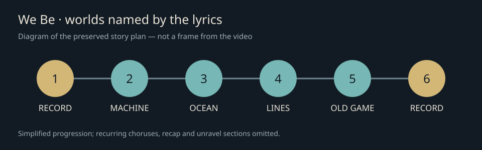
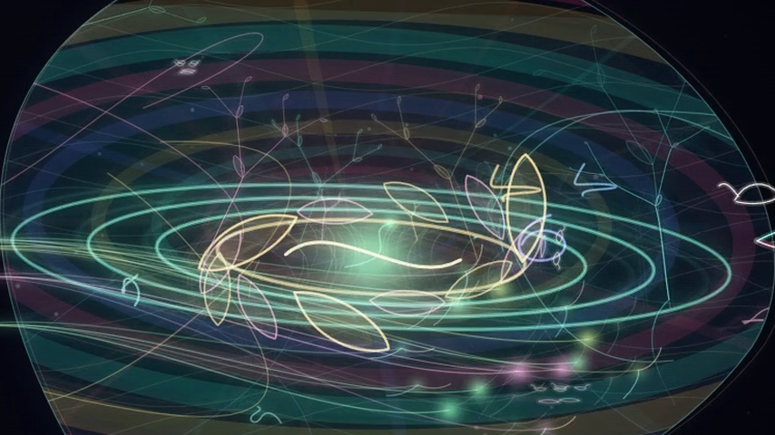
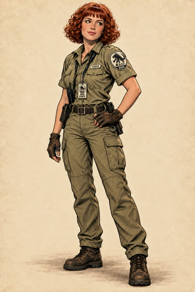
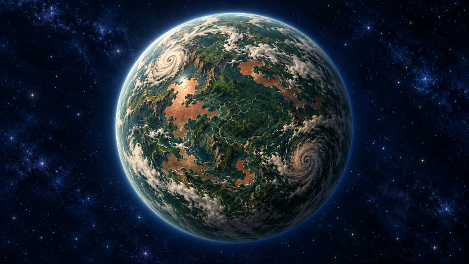
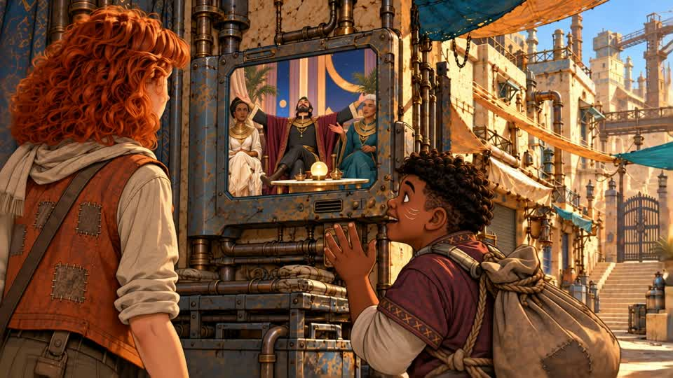

# Music Visualization Toolkit

A working collection of tools and project records for making music videos.
It combines musical timing, lyric alignment, visual experiments, shot planning,
review, and rendering. Some projects use procedural graphics; others use
illustrated references and generated footage.

This repository is both a reusable toolkit and a production notebook. It is
not yet a single application with a uniform workflow. The project folders
record the decisions, experiments, and revisions that shaped the shared tools.

## Intention

The aim is to keep visual storytelling connected to the music while making
creative decisions easy to inspect and revise.

A song's timing, lyrics, scene boundaries, shot lengths, source trims, and
transitions should remain explicit. An animatic provides a way to review those
decisions before committing to finished imagery or paid video generation.
Generated footage is selected and edited against that structure, rather than
determining the timing of the song.

The same foundation supports two approaches:

- **Procedural performance:** browser-based vector and 3D scenes driven by
  stems, MIDI notes, automation, lyrics, and musical structure.
- **Shot-based storytelling:** character and environment references, starter
  frames, directed video generations, and frame-accurate assembly.

The code favors small Python tools, JSON files, browser interfaces, and FFmpeg.
Project-specific solutions are retained alongside the more general tools;
reuse is developing through actual production work.

## Project history

This is the history recoverable from this repository, supplemented by Arne's
production recollections. Dates below identify saved checkpoints, not necessarily
when each project began or finished. Git does not contain every intermediate
render or every earlier experiment.

### We Be — the original toolkit

*The original images are not preserved here. This diagram summarizes the saved
story plan; it is not a screenshot or reconstruction of the finished video.*

The initial public toolkit was committed on August 29, 2026, extracting reusable
work from We Be. The surviving configuration describes a record-groove world,
machinery, ocean, lines, and an old-game section, each connected to the lyrics.
The early tools explored browser-based vector performance and Three.js worlds,
alongside shot planning and musical timing.

**What carried forward:** music as the organizing structure, readable
configuration, alternate visual approaches, and repeatable offline rendering.
**What survives:** [configuration examples](examples/we-be-config/README.md),
[world/story notes](examples/we-be-config/world/story.md), and shared tools.
The song, original images, and finished render are absent from this archive.

### Rivers of Mars — a complete browser-rendered video

*Frame from the completed video.*

The August 2026 checkpoint records a completed 3:23.708 narrative vector video.
An earlier Bitwig composition, human-written lyrics and vocal direction, a Suno
cover, and subsequent stem work in Bitwig supplied the musical material. The
visuals were rendered in the browser, with deterministic capture and temporal
supersampling for export.

The music-video register became a central working surface: lyrics, scene
direction, choreography, transitions, and stem/MIDI-driven motion shared one
musical timeline. The completed register records 87 lyric cues, 15 scenes,
15 transitions, and 63 choreography blocks.

**What carried forward:** an inspectable musical timeline, a live preview,
and deterministic rendering instead of manually rebuilding the edit.
**What survives:** renderer code, compact project metadata, selected stills,
a [register screenshot](docs/images/rivers-of-mars-register.png), and
[project notes](projects/rivers-of-mars/README.md).
[Watch the published video](https://youtu.be/FxzgJe0L55Y).

### Monsters Undone — illustrated performances and Blender compositing

*Preserved Harper identity reference, carried into the next project's reference
archive. This is character artwork, not a frame extracted from the V94 master.*

Stored under the earlier working name **monsters-loose**, this project shifted
toward generated character performances and Blender-based assembly and effects.
The September 2026 records include creature encounters, a zoo escape, speech
balloons, countdown graphics, tracked warning beacons, and reflections.

The saved endpoint is V94: a standalone video and a 1920×1080 master,
5,290 frames at 24 fps. Its source material mixes native 1080p footage with
some effects baked at 720p and scaled for the master. The handoff records
deferred performance-polish issues rather than treating every take as final.

**What carried forward:** Harper's identity, precise source-frame selections,
generated acting directed shot by shot, and a review loop for combining footage
with authored effects.
**What survives:** extensive production notes, recovery metadata, prompts,
assembly/effect scripts, and an inventory of the original external workspace.
The full media collection is not in Git.
See the [handoff](projects/monsters-loose/HANDOFF.md).

### A Right Little Something — spatial continuity and layered effects

*Preserved planet-reveal starter/reference image; not a claim about the final
composited frame.*

The October 2026 work extended the illustrated workflow into space travel,
ship design, station encounters, and first contact. Timing work reconciled
DAWproject automation with the master recording before scene planning.
Generated Kling footage was combined with Blender camera movement, ship
experiments, and layered compositing.

The accepted V65 checkpoint records a full 5,265-frame, 24 fps, 1080p movie.
Late revisions worked on sphere transmission/refraction, separating foreground
and background layers, departure motion, framing, and the ending. Earlier
opening shots still had recorded opportunities to better match the accepted
ship design.

**What carried forward:** stronger reference continuity, explicit geometry,
separate compositing layers, and the habit of preserving earlier versions
while refining a small part of the edit.
**What survives:** [curated references](projects/a-right-little-something/reference-images/README.md),
timing checkpoints, direction notes, and reproducible production scripts.
See the [V65 handoff](projects/a-right-little-something/PRODUCTION-HANDOFF.md)
for the saved state; older intake notes describe earlier stages.

### Together Anyways — a lighter compositing workflow

*Frame from the clean 1080p first-draft export.*

The latest project follows Harper and Taffy through a theft, a salvage-yard
bargain, and an attempted escape. Early character and setting exploration is
preserved under [desert-colony](projects/desert-colony/character-development/README.md);
the production workspace is Together Anyways.

By November 3, 2026, the complete draft contains 70 animated shots across
14 scenes: 5,190 frames at 24 fps, or 3:36.25. Work covered cast silhouettes
and heights, clothing and biological details, consistent ship geometry,
motivated performances, camera movement, and repeated continuity checks.
The reviewer gained scene/shot and lyric/instrumental navigation, source
in-points, and shot-duration information.

This project introduced EffectCraft in place of Blender for the compositing
workflow, using its MCP control interface. The saved native EffectCraft
animatic and pinned Mac app/CLI setup document that transition. The later
shot-based animatic and clean export also have Python/Pillow/FFmpeg assembly
tools, so the recorded workflow spans more than one renderer.

**What carried forward:** faster iteration on predominantly 2D work,
frame-accurate review, and portable media backups.
**What survives:** shotlists, prompts, revision history, source recovery links,
reference media, and both the latest annotated animatic and clean 1080p export.
See the [continuation notes](projects/together-anyways/CONTINUE-HERE.md) and
[backup release](https://github.com/ArneGleason/music-visualization-toolkit/releases/tag/together-anyways-20261103-v004-stills).

## How the tools changed

The broad progression has been **browser-based rendering → Blender-based
compositing and 3D work → EffectCraft for the newer compositing workflow**.
These are overlapping approaches, not complete replacements of everything that
came before.

[EffectCraft](https://github.com/storytold/effectcraft) is an open-source motion
graphics and compositing application with an After Effects-style workflow.
Its project describes a from-scratch Rust implementation, rather than a port
of Adobe code. Arne adopted it as an AI-developed alternative whose MCP
interface made it practical to drive from the assistant. The repository pins
version 0.18.0 for the saved Mac workflow.

In Arne's experience, EffectCraft rendered the kind of compositing used here
about **three times faster than Blender**. That is a production observation,
not a controlled benchmark or a claim about every workload. Recent work
depended more on layers, camera moves, transitions, and overlays than on full
3D scenes.

The likely next arrangement is to use Blender where actual 3D modeling and
rendering help, and EffectCraft—or another suitable tool—for compositing.
The lasting investment is the music, timing, references, creative decisions,
and knowledge of what works. Keeping those explicit makes it easier to switch
tools, combine them, and build on earlier experiments without letting the cost
of learning one application determine every future choice.

## Current status

As of **November 3, 2026**:

| Project | State |
| --- | --- |
| Rivers of Mars | Completed and published narrative vector music video. |
| Monsters Undone | V94 standalone video and 1080p master recorded; selected polish items remain deferred. |
| A Right Little Something | Accepted V65 working version; further shot refinements recorded in its handoff. |
| Together Anyways | Complete first video draft: 70 animated shots, 14 scenes, 5,190 frames at 24 fps (3:36.25). Latest animatic and clean 1920×1080 export backed up. Further polish remains possible. |

Together Anyways is the most recent production checkpoint. Its
[continuation notes](projects/together-anyways/CONTINUE-HERE.md) identify the
selected shots, accepted revisions, known caveats, and restore instructions.
The [current backup release](https://github.com/ArneGleason/music-visualization-toolkit/releases/tag/together-anyways-20261103-v004-stills)
contains reference media and the two complete video renders.

The toolkit remains a working repository rather than a packaged library.
Some scripts still assume a particular project's paths, schema, or visual
layout. The DAW-driven vector workflow and the generated-footage workflow
share timing concepts but have different renderers. Existing projects are the
best examples of how the pieces fit together.

## Where to look

| Location | Purpose |
| --- | --- |
| tools/ | Timing, alignment, planning, review, rendering, and media-backup scripts. |
| projects/ | Project configuration, timelines, shotlists, prompts, production history, and handoff notes. |
| stage/, world/, video/ | Browser-based vector-stage and 3D visualization work. |
| examples/we-be-config/ | Lightweight configuration examples from the original project. |
| docs/ | Focused workflow and implementation guides. |

Useful guides:

- [Timeline register](docs/TIMELINE.md): musical positions, lyrics, scenes, and compilation to frame boundaries.
- [Alignment](docs/ALIGNMENT.md): lyric and timing work.
- [Narrative video](docs/VIDEO.md): the illustrated browser-rendering workflow.
- [Frame review](docs/FRAME_REVIEW.md): playback, precise stepping, and review notes.
- [Exports](docs/EXPORTS.md): rendering and export details.

Production notes and older generation guides describe the tools and services
used at the time. They are not guarantees about current service features or pricing.

## Working principles

- For shot-based edits, the project's shots/shotlist.json is the authority.
- Derive frame boundaries from the timing grid. Prefer DAWproject timing when
  continuous tempo ramps matter; MIDI tempo events are discrete steps.
- Re-plan existing shotlists with tools/shotplan.py --merge to preserve
  authored creative work.
- Review the animatic before spending on generated footage.
- Preserve reference identities, shared prompt locks, selected takes, source
  in-points, and the reasons for revisions.
- Keep the review presentation separate from the clean video export.

## Setup and entry points

The core tools use Python 3.10+, FFmpeg, and ffprobe. Browser-rendering tools
also use Playwright/Chromium. Individual experiments may require additional
software such as Blender. Workflows have been exercised on macOS and Windows,
but not every tool has identical setup on both.

On macOS or a compatible shell:

    bash setup.sh

Run Python tools through the repository environment:

    ./.venv/bin/python3 tools/timeline.py sync projects/<slug>/project.json

On Windows, use .venv/Scripts/python.exe in place of ./.venv/bin/python3.
For an existing project, read its README or handoff before rebuilding anything.
For a new project, use the example configuration and
[timeline guide](docs/TIMELINE.md); supply your own audio and timing inputs.

To review a rendered video:

    ./.venv/bin/python3 tools/frame_review.py --video /absolute/path/video.mp4 --notes /absolute/path/review-notes.json

The original run.sh shortcuts remain available for timing, vector-stage,
world, and shot-edit workflows. Check their project assumptions before using
them with another song.

## What Git stores—and what it does not

Git stores code, configuration, shotlists, prompts, notes, and selected compact
reference assets. Large audio, generated footage, decoded frame caches, and
renders stay outside Git, usually under ignored generated/ directories.

**A clone alone does not restore a production workspace.** Backup coverage
varies by project. Rivers of Mars has a published video; A Right Little
Something and Monsters Undone have handoffs describing their local-media requirements.

Together Anyways has two tracked manifests pointing to versioned GitHub
Release archives:

- [media-manifest.json](projects/together-anyways/media-manifest.json):
  reference stills, review boards, audio, and project assets.
- [render-media-manifest.json](projects/together-anyways/render-media-manifest.json):
  the latest annotated animatic and clean full-frame 1080p video.

Restore them from the repository root:

    ./.venv/bin/python3 tools/project_media.py restore projects/together-anyways/media-manifest.json
    ./.venv/bin/python3 tools/project_media.py restore projects/together-anyways/render-media-manifest.json

Restoration checks SHA256 hashes and refuses to overwrite conflicting local
files. Individual Kling source clips and decoded caches are not included in
these archives; selected clip recovery URLs are recorded in
[video-recovery.json](projects/together-anyways/shots/video-recovery.json).
Earlier backup releases and rejected creative variants are retained so the
production history remains recoverable.
